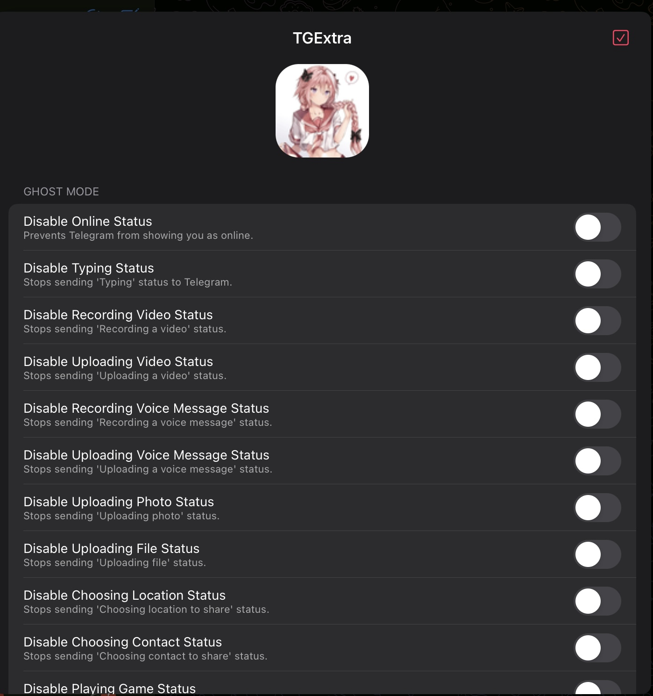
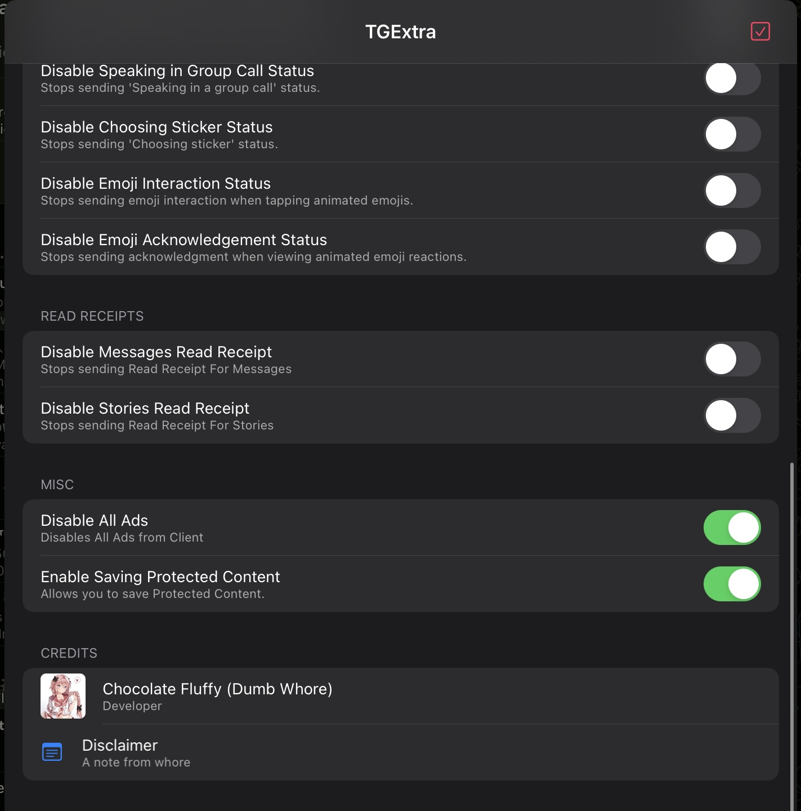

# TGExtra
A simple Telegram iOS Tweak.

To Open Tweak menu : Longpress screen with 3 finger (if no flex injected) of 4 fingers.

## Screenshots

## 1.3.0 (updated fork)
- Removed the bundled Telegram Swift `Api` copy (stuck at an old layer, broke on every update). Replaced with a small schema-driven C walker (`Sources/tgapi/TLWalker.c`) whose table is regenerated **on every CI build** from the latest Swiftgram + tdesktop TL schema (`tools/gen_schema.py`).
- Protected-content bypass works again on current clients (message/chat/channel/story `noforwards` cleared in API responses *and* push updates).
- NEW: Keep deleted messages (anti-delete, new deletions only), no "listened" marks for voice/round messages, story view-increment blocked, sponsored peers in search hidden, Local Premium (client-side only).
- Fixed: "Disable All Ads" used the same key as "Disable Online Status".

## Features

- Disable Ads
- Ghost Mode
- No Read Receipt for messages and Stories
- Allow saving Protected Content ( Due to frequenet Telegram Api updates this feature is only limited for client compiled with 11.8.1 sources)

## Disclaimer

This project is an **independent modification (tweak)** for the Telegram app. I am **not affiliated, associated, authorized, endorsed by, or in any way officially connected with Telegram Messenger LLP**, or any of its subsidiaries or affiliates.

This tweak is created solely for **personal and educational purposes**. Use it at your own risk.

**I do not take any responsibility for any issues, damages, or consequences** resulting from the use or misuse of this tweak. If something breaks, it's not my problem.
